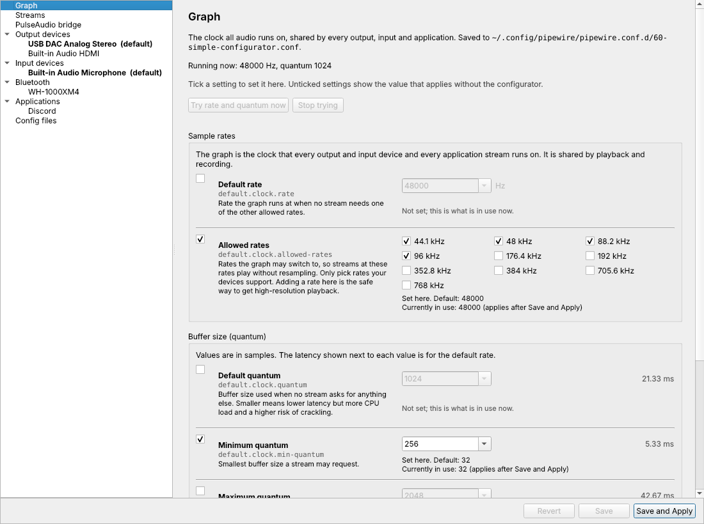
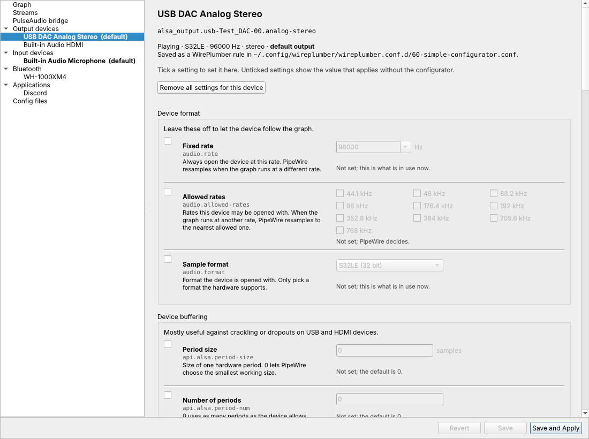
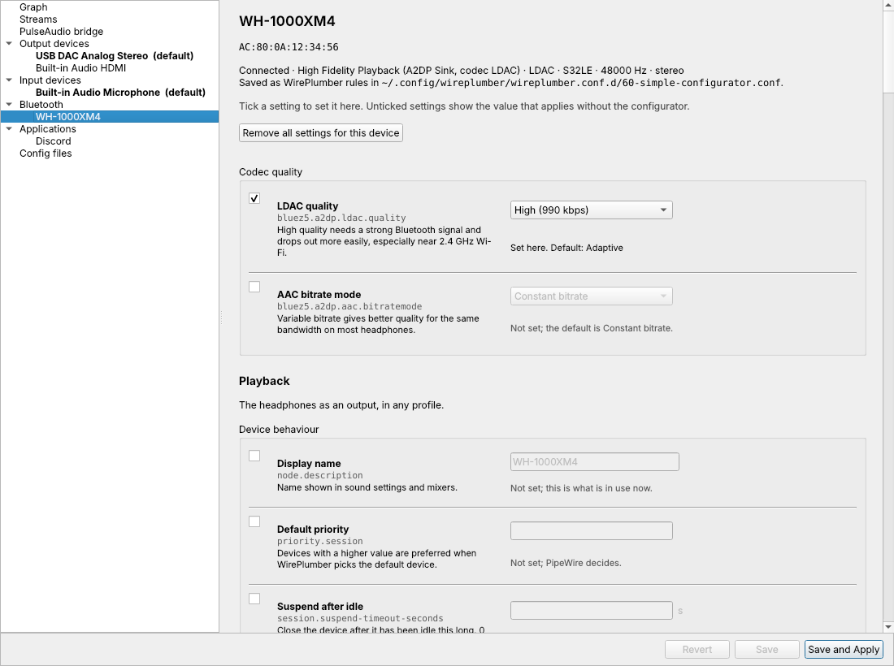

#  PipewireSimpleConfigurator

A GUI for the PipeWire and WirePlumber settings you would otherwise edit by hand: sample rates and buffer sizes of the graph, resampler and channel mixing, per-device and Bluetooth settings, and per-application tweaks.



## What you can configure

| Page | What | Written to |
| --- | --- | --- |
| **Graph** | Default and allowed sample rates, quantum (buffer size) settings, power-of-two rounding. The quantum limit is also written to the client configs, because applications size some of their own buffers from it. A *Try now* button applies rate and quantum to the running graph without saving. | `pipewire.conf.d` (quantum limit also in `client.conf.d`, `pipewire-pulse.conf.d`, `jack.conf.d`) |
| **Streams** | Defaults for every application stream: requested latency, forced rate, resampler, channel mixing, dither, filter graphs | `client.conf.d`, `pipewire-pulse.conf.d` (and `client-rt.conf.d` on PipeWire before 1.4) |
| **PulseAudio bridge** | Buffer sizes for applications that use the PulseAudio API | `pipewire-pulse.conf.d` |
| **Output / input devices** | Per sound card output or input: fixed or allowed rates, sample format, ALSA period size and headroom, suspend timeout, display name, default priority, resampler and channel mixing | WirePlumber `monitor.alsa.rules` |
| **Bluetooth** | Allowed codecs, SBC-XQ, mSBC, codec sample rate, profiles (roles), hardware volume, automatic switch to the headset profile; per headphone: LDAC quality, AAC bitrate mode, and settings for its playback and microphone nodes | WirePlumber `monitor.bluez.*`, `wireplumber.settings` |
| **Applications** | Per program (matched by process name): latency, resampler quality, upmixing, PulseAudio buffer sizes and quirks such as "block microphone volume changes" | `pipewire-pulse.conf.d` (`pulse.rules`, `stream.rules`) |

Every setting has a check box. Ticked means the configurator writes the value, even if it equals today's default, so a later PipeWire update cannot change it behind your back. Unticked means the configurator leaves it alone; the page then shows the value that applies anyway and where it comes from (a config file, the running device, or PipeWire's default).

Pages warn about combinations that do not work, for example a default rate that is not in the allowed rates, quantum limits in the wrong order, or Bluetooth without the SBC codec.

## How it stores settings

The configurator only writes its own drop-in files:

```
~/.config/pipewire/pipewire.conf.d/60-simple-configurator.conf
~/.config/pipewire/client.conf.d/60-simple-configurator.conf
~/.config/pipewire/client-rt.conf.d/60-simple-configurator.conf     (PipeWire before 1.4 only)
~/.config/pipewire/pipewire-pulse.conf.d/60-simple-configurator.conf
~/.config/pipewire/jack.conf.d/60-simple-configurator.conf
~/.config/wireplumber/wireplumber.conf.d/60-simple-configurator.conf
```

PipeWire loads exactly one main file per config (the first it finds in `~/.config/pipewire`, `/etc/pipewire`, `/usr/share/pipewire`), then merges the drop-ins from all three `*.conf.d` folders on top: `/usr/share` first, then `/etc`, then `~/.config`, alphabetically within each folder. Later drop-ins override single keys of earlier ones, and lists such as rules are appended. So PipeWire and WirePlumber load these files on top of their normal configuration, so your other config files are never changed and PipeWire updates to the main files keep working. To undo everything, delete these files (or use *Remove all configurator settings* on the *Config files* page). Drop-ins in `~/.config` that sort after `60-simple-configurator.conf` are loaded later and win; the configurator shows a warning on every setting they override.

**Save** writes the files. **Save and Apply** also restarts only the services that read the changed files (`pipewire`, `pipewire-pulse`, `wireplumber`). Native PipeWire applications read stream settings when they start, so restart them afterwards.

### Upgrading from version 0.1

Version 0.1 saved complete copies of `pipewire.conf`, `pipewire-pulse.conf` and `client.conf` in `~/.config/pipewire`. Such copies replace the system files entirely. When the configurator finds them, it offers to import their settings and rename the copies to `*.bak-<date>`.

## Requirements

- PipeWire with its command line tools (`pw-dump`, `pw-metadata`; package `pipewire-bin` on Debian/Ubuntu, `pipewire-utils` on Fedora)
- WirePlumber 0.5 or newer for the device and Bluetooth pages. With WirePlumber 0.4, which uses Lua configuration, these pages are read-only.
- Qt 6.2 or newer (Widgets)

## Build

```
mkdir build && cd build
cmake ..
make -j$(nproc)
ctest            # optional, runs the unit and UI tests
```

Then run `./SimplePipewireConfigurator` directly, or build a package for your distribution:

| Distribution | Command | Result |
| --- | --- | --- |
| Arch, Manjaro, EndeavourOS | `makepkg -si` in the repository root | `pipewire-configurator-simple-<version>-1-x86_64.pkg.tar.zst` in the repository root, installed |
| Debian, Ubuntu, Mint | `cpack -G DEB` in the build folder (needs `dpkg-dev`) | `pipewire-configurator-simple_<version>_amd64.deb` |
| Fedora, openSUSE | `cpack -G RPM` in the build folder (needs `rpm-build`) | `pipewire-configurator-simple-<version>-1.x86_64.rpm` |

`cpack` without `-G` builds both the .deb and the .rpm. Build each package on the distribution (and release) it is meant for: the library dependencies are taken from the system it is built on. The PKGBUILD builds from the files in the repository, so nothing is downloaded.

Build dependencies: CMake 3.16+, a C++17 compiler and Qt 6.2+ (`qt6-base-dev` on Debian/Ubuntu, `qt6-qtbase-devel` on Fedora, `qt6-base` on Arch).

For development, `--pw-dump FILE` reads devices from a saved `pw-dump` output, `--page ID` opens a page and `--screenshot FILE` saves a screenshot and quits.

## Pictures




